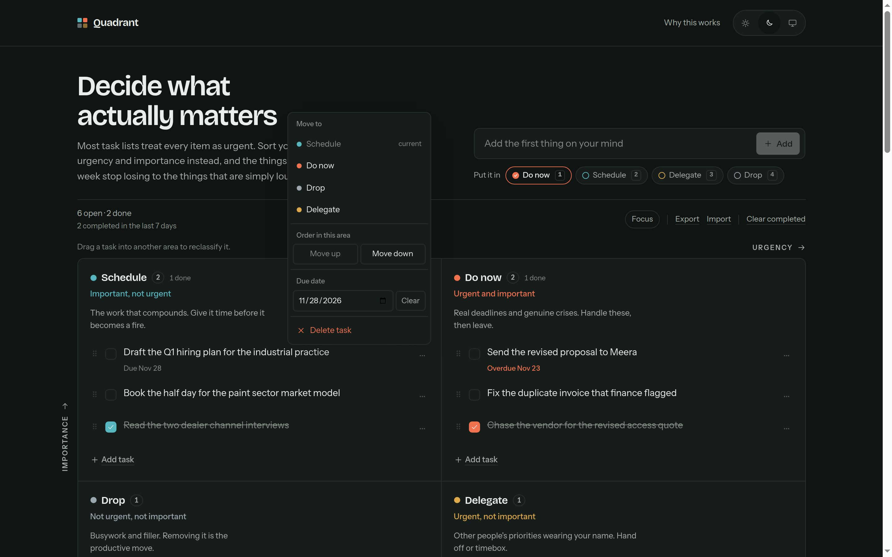
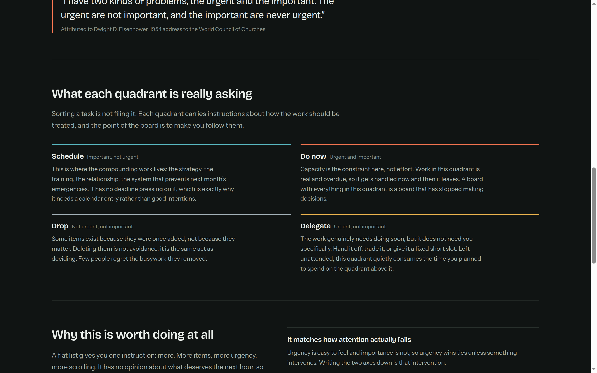
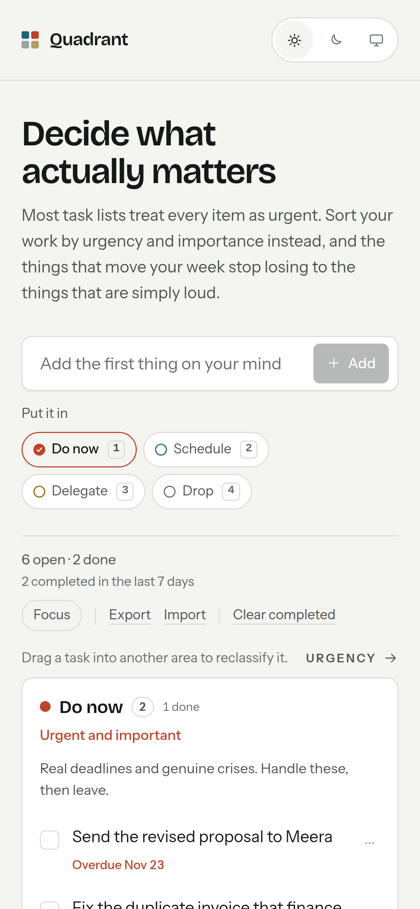

<div align="center">


# Quadrant

**A four-quadrant task board that makes you decide what actually matters.**

Sort any task by urgency and importance, watch the board tell you what deserves today, and read why the method works while you use it.

[](https://quadrant-tasks-nine.vercel.app)
[](https://react.dev)
[](https://vitejs.dev)
[](https://tailwindcss.com)
[](https://www.typescriptlang.org)
[](#privacy)
[](LICENSE)

[How it works](#how-the-board-works) · [Run locally](#run-it-locally) · [Keyboard shortcuts](#keyboard-shortcuts) · [Why the method works](#why-four-quadrants)

</div>


## What this is

Most to-do apps give you one instruction: more. Quadrant asks two questions instead. Is this urgent? Is this important? Your answer decides where the task lives, and the position on the board decides how you treat it.

**Live app: [quadrant-tasks-nine.vercel.app](https://quadrant-tasks-nine.vercel.app)**

Everything runs in the browser. There is no account, no server, no database and no analytics.

## Features

| | |
| --- | --- |
| **Four quadrant board** | Do now, Schedule, Delegate and Drop, arranged on real urgency and importance axes |
| **Drag to reclassify** | Move a task between quadrants with a drag, or use the row menu on touch devices |
| **Instant capture** | One input with quadrant chips and number keys 1 to 4, plus a quick add inside every quadrant |
| **Persistent board** | Tasks and theme are saved to `localStorage` and survive a reload |
| **Light, dark and system themes** | Follows your operating system preference by default, with an explicit override |
| **Undo on delete** | Deleted tasks can be restored from the toast |
| **Keyboard and screen reader support** | Native checkboxes, labelled controls, visible focus rings, Escape to close menus |
| **Reduced motion respected** | All animation collapses under `prefers-reduced-motion` |
| **Responsive down to 360px** | The matrix becomes a priority-ordered stack on phones |

## How the board works

Importance runs up the vertical axis. Urgency runs right along the horizontal axis. That gives four cells, and each one is an instruction rather than a label.

```text
                    URGENT                  NOT URGENT
              ┌─────────────────────┬─────────────────────┐
  IMPORTANT   │  Do now             │  Schedule           │
              │  deadlines, crises  │  leverage, planning │
              ├─────────────────────┼─────────────────────┤
NOT IMPORTANT │  Delegate           │  Drop               │
              │  other priorities   │  busywork, filler   │
              └─────────────────────┴─────────────────────┘
```

- **Do now** is capacity constrained. Handle it, then leave.
- **Schedule** is the quadrant that compounds. It has no deadline, which is exactly why it needs one.
- **Delegate** needs doing soon but does not need you specifically.
- **Drop** exists because it was once added, not because it matters.

On a phone the same four areas stack in priority order: Do now, Schedule, Delegate, Drop.

## Screenshots

| Light | Dark |
| --- | --- |
|  |  |



<p align="center">
  
</p>

## Run it locally

Requirements: Node.js 18 or newer and npm.

```bash
git clone https://github.com/GautamVhavle/quadrant.git
cd quadrant
npm install
npm run dev
```

Vite serves the app at `http://localhost:5173`.

```bash
npm run build      # production bundle in dist/
npm run preview    # serve the production bundle
npm run typecheck  # TypeScript check
```

## Deploy

The app is a static site, so any static host works. It is deployed on Vercel at [quadrant-tasks-nine.vercel.app](https://quadrant-tasks-nine.vercel.app).

```bash
npx vercel        # preview deployment
npx vercel --prod # production deployment
```

Framework preset: **Vite**. Build command: `npm run build`. Output directory: `dist`.

## Keyboard shortcuts

| Key | Action |
| --- | --- |
| `1` `2` `3` `4` | Choose the destination quadrant while typing a task |
| `Enter` | Add the task |
| `Escape` | Clear the input, or close an open row menu |
| `Tab` | Move between checkbox, task title and row menu |

## Project structure

```text
src/
├── components/
│   ├── Composer.tsx       capture bar with quadrant chips
│   ├── Matrix.tsx         the 2x2 board and axis labels
│   ├── QuadrantPanel.tsx  one quadrant, its tasks and quick add
│   ├── TaskRow.tsx        checkbox, inline rename, move menu, delete
│   ├── Explainer.tsx      the long-form explanation of the method
│   ├── Header.tsx         brand and theme control
│   ├── Toast.tsx          undo affordance
│   └── Icons.tsx          inline SVG set
├── lib/
│   ├── types.ts           task and quadrant definitions
│   ├── useTasks.ts        task state, counts and persistence
│   ├── storage.ts         localStorage read and write, theme handling
│   └── utils.ts           class merging and ids
├── App.tsx
├── index.css              design tokens, light and dark palettes
└── main.tsx
```

## How it is built

- **React 18 with Vite** for a small static bundle and fast builds.
- **Tailwind CSS with CSS custom properties** so a single token file drives both palettes instead of duplicated `dark:` classes.
- **A single state hook** (`useTasks`) owns tasks, derived per-quadrant counts and persistence, so components stay presentational.
- **HTML5 drag and drop** with a row menu fallback, which keeps reclassification available on touch and keyboard.
- **No component library dependency** and no runtime CSS-in-JS. The production bundle is roughly 190 kB of JavaScript before gzip.
- **Theme resolution order**: explicit choice, then system preference, then light. `color-scheme` is declared so form controls and scrollbars follow.

## Privacy

Tasks live in `localStorage` under `quadrant.tasks.v1`. The theme lives under `quadrant.theme.v1`. Nothing leaves the browser, and there is no network call after the page loads apart from the web fonts.

Clearing site data removes the board completely.

## Why four quadrants

The method is usually credited to Dwight Eisenhower, who insisted that urgent work is rarely important and important work is rarely urgent. Stephen Covey made the grid popular.

It is a decision heuristic, not a measurement. It says nothing about sequence, effort or dependencies, and it has a well known failure mode: parking everything in Do now because being busy feels like being valuable. The honest test of the method is whether Schedule has something real in it this week.

The app explains this in full inside the page, including where the method stops being useful.

## Roadmap

- Optional due dates and a daily focus view
- Keyboard-first reordering without the pointer
- Import and export of a board as JSON
- A week review mode that shows what moved between quadrants
- Optional sync for people who want their board on more than one device

## Contributing

Issues and pull requests are welcome. Keep changes focused, run `npm run typecheck` and `npm run build` before opening a pull request, and explain any change to the interaction model, because the board is the product.

## License

MIT. See [LICENSE](LICENSE).
