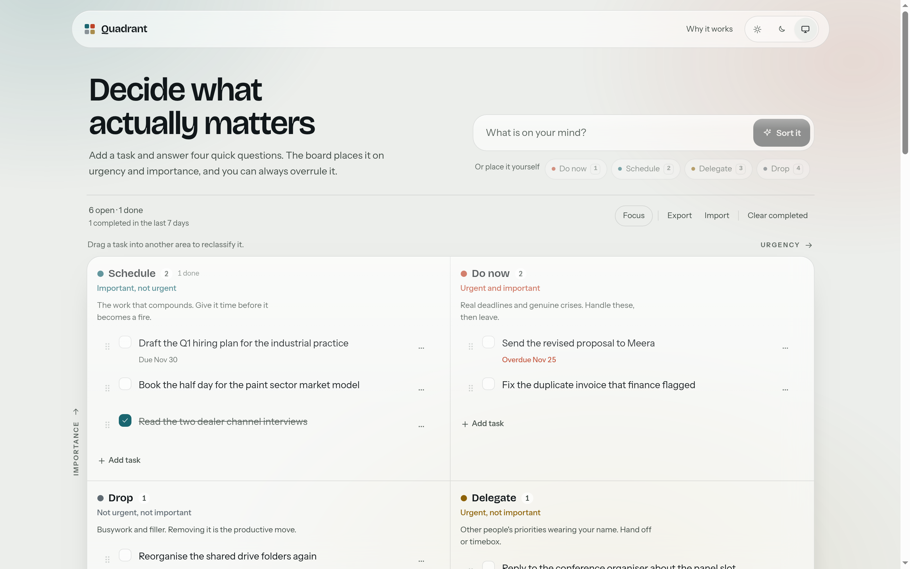
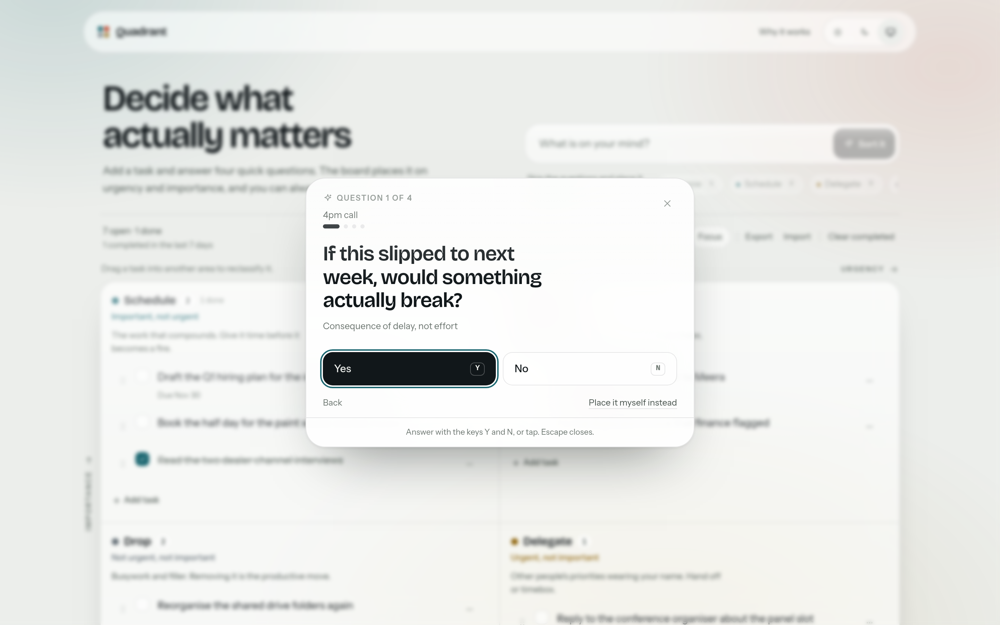
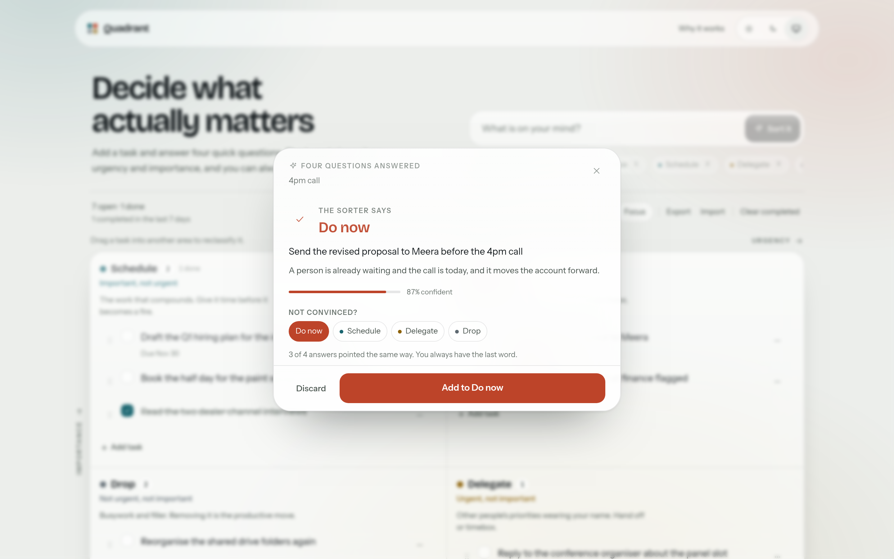
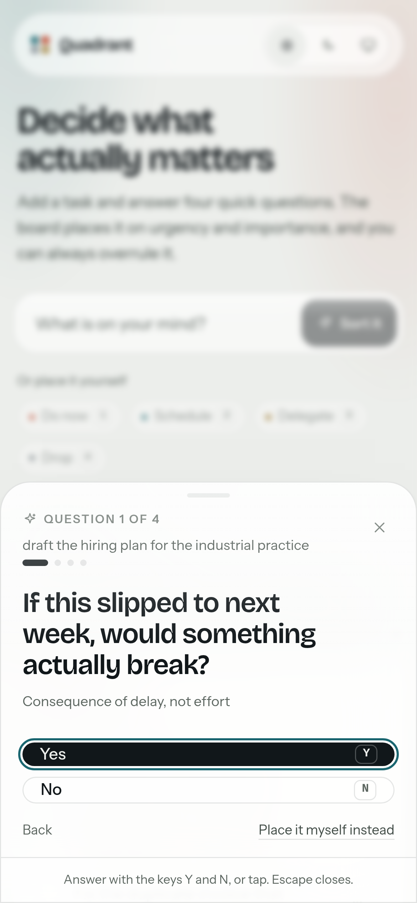

<div align="center">


# Quadrant

**Four questions, then one honest decision about what to do next.**

Add a task and Quadrant asks four yes or no questions about it. A model reads your answers, places the task on an urgency and importance board, and explains itself in one line. You can always overrule it.

[](https://quadrant-tasks-nine.vercel.app)
[](https://nextjs.org)
[](https://react.dev)
[](https://www.typescriptlang.org)
[](https://tailwindcss.com)
[](https://motion.dev)
[](#testing)
[](#testing)
[](LICENSE)

[How it works](#how-it-works) · [Run locally](#run-locally) · [API](#the-api) · [Testing](#testing)

</div>



## What this is

Most to do lists give you one instruction: more. Quadrant asks two questions instead. Is this urgent? Is this important? Your answer decides where the task lives, and its position on the board decides how you treat it.

The four questions exist because people answer "is this important" badly when they are busy. They answer "would something break if this slipped to next week" much more honestly. So the assistant asks the smaller, sharper questions and does the mapping for you.

**Live app: [quadrant-tasks-nine.vercel.app](https://quadrant-tasks-nine.vercel.app)**

No account, no database, no analytics. Tasks stay in your browser. The only thing that leaves is the task text you choose to sort, for the length of one request.

## How it works

1. Type a task and press **Sort it**.
2. Answer four yes or no questions, one at a time. Keys `Y` and `N` work.
3. A model reads the task plus the answers and returns a quadrant, a one line reason, and a confidence value.
4. You see the verdict and can accept it, pick a different quadrant yourself, or discard.
5. The task animates into its area.

Manual paths stay first class. The chips under the input place a task directly when you already know where it belongs, the number keys `1` to `4` do the same while typing, and every task can be moved later from its row menu.

| Urgent | Important | Quadrant |
| --- | --- | --- |
| yes | yes | Do now |
| no | yes | Schedule |
| yes | no | Delegate |
| no | no | Drop |

Urgent means "something breaks if it slips" or "someone is waiting with a date". Important means "it moves a goal you would defend". The fourth question, about whether someone else could do it, sharpens the Delegation case.

### The sheet

| Question | Verdict |
| --- | --- |
|  |  |

### On a phone

| Board | Sheet |
| --- | --- |
|  |  |

### Dark mode


## The API

`POST /api/triage` is a Next.js route handler, so it runs as a Vercel function.

```json
// request
{ "task": "send the revised proposal", "answers": { "q1": true, "q2": true, "q3": true, "q4": false } }

// response
{
  "verdict": {
    "quadrant": "do",
    "title": "Send the revised proposal",
    "reason": "A person is already waiting and the call is today.",
    "confidence": 0.87,
    "source": "model",
    "mode": "online"
  },
  "remaining": 9
}
```

Behaviour that matters:

- **It never blocks the product.** If the model is slow, wrong, or unreachable, the route falls back to the deterministic mapping above and marks the result `source: "heuristic"`. The interface says which one it used instead of pretending.
- **It works with no key.** Without `OPENROUTER_API_KEY` the route returns the rule based verdict with `mode: "offline"`, so a fresh clone is fully usable.
- **It validates everything.** The request body is checked field by field, and the model's JSON is parsed and clamped before it is allowed near the interface.
- **It rate limits.** 12 requests per IP per 10 minutes by default, with a `429` and a `Retry-After` header. The sheet explains the wait and offers the manual path.
- **No key reaches the browser.** The OpenRouter call happens only on the server.

## Rate limiting, honestly

The limiter is an in memory sliding window, configurable with `TRIAGE_REQUESTS_PER_WINDOW` and `TRIAGE_WINDOW_SECONDS`. It stops a single client hammering the endpoint, which is the realistic risk for a public demo.

It is per server instance, so a cold start resets it and two concurrent functions count separately. For real traffic the same interface should be backed by a shared store such as Upstash Redis. The limiter is written as a pure factory with an injected clock, so swapping the storage does not touch the calling code.

## Run locally

```bash
git clone https://github.com/GautamVhavle/quadrant.git
cd quadrant
npm install
cp .env.example .env.local   # optional, see below
npm run dev
```

Open `http://localhost:3000`.

| Variable | Purpose |
| --- | --- |
| `OPENROUTER_API_KEY` | Enables the model. Leave it out and the app runs on the rule based mapping. |
| `OPENROUTER_MODEL` | Any OpenRouter model id. Defaults to a small fast model. |
| `TRIAGE_REQUESTS_PER_WINDOW` | Optional. Defaults to 12. |
| `TRIAGE_WINDOW_SECONDS` | Optional. Defaults to 600. |

| Command | What it does |
| --- | --- |
| `npm run dev` | Next.js dev server |
| `npm run build` | Production build |
| `npm start` | Serve the production build |
| `npm run typecheck` | TypeScript across app, components, lib and tests |
| `npm test` | Unit tests |
| `npm run test:e2e` | Browser tests, building and starting the app |
| `npm run verify` | Typecheck, unit tests, build |

## Deploy

```bash
npx vercel --prod
```

Set `OPENROUTER_API_KEY` in the Vercel project before the first production deploy if you want the model path live. Without it the deployment still works and says it is running on the rule.

## Your data

- Tasks and preferences live in `localStorage` under `quadrant.tasks.v1`, `quadrant.theme.v1` and `quadrant.focus.v1`.
- **Export** downloads the board as JSON. **Import** validates the file before touching your board, so a bad file changes nothing.
- **Focus mode** hides Delegate and Drop without deleting anything.
- Fonts are self hosted in `public/fonts`, so a page load makes no third party requests.

## Project structure

```text
app/
├── layout.tsx           metadata, theme bootstrap, fonts
├── page.tsx             board, explainer, footer
├── globals.css          glass tokens for both palettes
├── fonts.css            generated @font-face rules
└── api/triage/route.ts  the server side verdict

components/
├── Board.tsx            state, toolbar, sheet orchestration
├── Composer.tsx         capture with a manual placement path
├── TriageSheet.tsx      four questions, verdict, override, keyboard, focus trap
├── Matrix.tsx           the 2x2 board and axis labels
├── QuadrantPanel.tsx    one area, its tasks, quick add
├── TaskRow.tsx          checkbox, rename, due chip, row menu
├── Header.tsx           brand and theme control
├── Explainer.tsx        the long form method explanation
├── SiteFooter.tsx       credit and privacy line
├── Toast.tsx            undo affordance
└── Icons.tsx            inline SVG set

lib/
├── triage.ts            questions, mapping, parsing, pure and tested
├── taskLogic.ts         task operations and import validation
├── useTasks.ts          state hook built on taskLogic
├── storage.ts           localStorage, theme, focus, export, import
├── types.ts             task and quadrant definitions
├── utils.ts             class merging and ids
└── server/
    ├── openrouter.ts    chat completion with a strict JSON contract
    └── rateLimit.ts     sliding window limiter, injectable clock
```

## How it is built

- **Next.js App Router.** The board is a client component, the reasoning is a route handler, and the explainer stays a server component.
- **Frosted glass from one token file.** Every surface is translucent with a backdrop blur, a hairline and one shadow step. Light and dark come from the same tokens, resolved as explicit choice, then system preference, then light.
- **Motion with a job.** A spring brings the sheet in, questions slide in the direction you answered, the verdict fades up, and the row animates into the board. All of it collapses under `prefers-reduced-motion`.
- **No LangChain.** Four fixed questions with a strict JSON contract are smaller and easier to reason about than a framework, and the fallback path stays obvious.
- **Task logic is pure functions,** which is why 69 unit tests run in under a second with no DOM.

## Testing

```bash
npm test          # 69 unit tests
npm run test:e2e  # 19 browser tests
```

Unit tests cover the mapping table for all sixteen answer combinations and the boundaries around it, confidence behaviour, request and model output validation, the rate limiter windows and refill, title clamping, and the whole task algebra: add, toggle, move, reorder, counts, overdue, and import validation.

Browser tests cover both paths end to end: the four question flow by keyboard and by button, going back, accepting, overruling the verdict before accepting, the rate limit message and the manual escape hatch, the degraded model notice, Escape and backdrop close, plus direct placement, reordering, undo, due dates, focus mode, theme persistence, export, a rejected import, and a 360px check for horizontal overflow.

The API is intercepted in browser tests, so they never call a real model.

## Why four quadrants

The method is usually credited to Dwight Eisenhower, who insisted that urgent work is rarely important and important work is rarely urgent. Stephen Covey made the grid popular.

It is a decision heuristic, not a measurement. It says nothing about sequence, effort or dependencies, and it has a well known failure mode: parking everything in Do now because being busy feels like being valuable. The honest test of the method is whether Schedule has something real in it this week.

The app explains all of this inside the page, including where the method stops being useful.

## Roadmap

- A weekly review that shows what moved between quadrants, not just what was completed
- Streaming the reason token by token instead of waiting for the whole verdict
- Optional due date suggestions from the answers
- A shared board for two people, if it can be done without accounts
- Swapping the in memory limiter for a shared store

## License

MIT. See [LICENSE](LICENSE).

<div align="center">

Made with ♥ by [Gautam Vhavle](https://gautamvhavle.xyz/)

</div>
