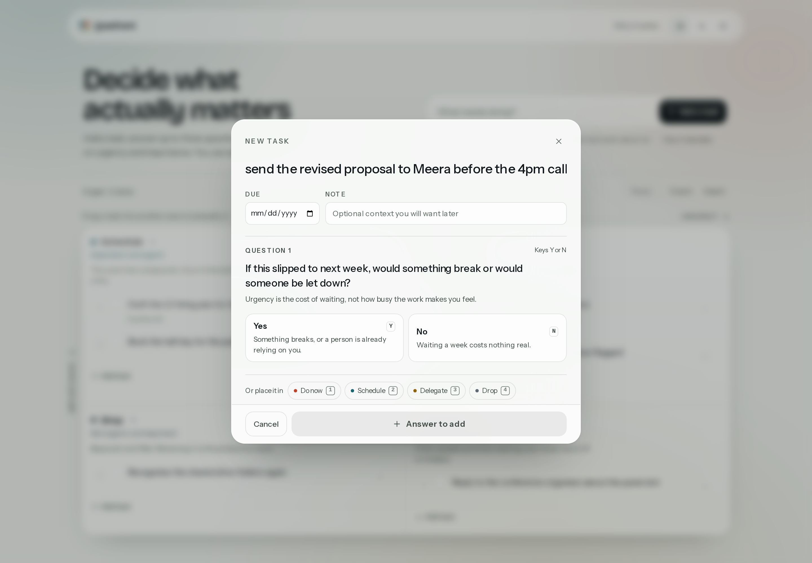
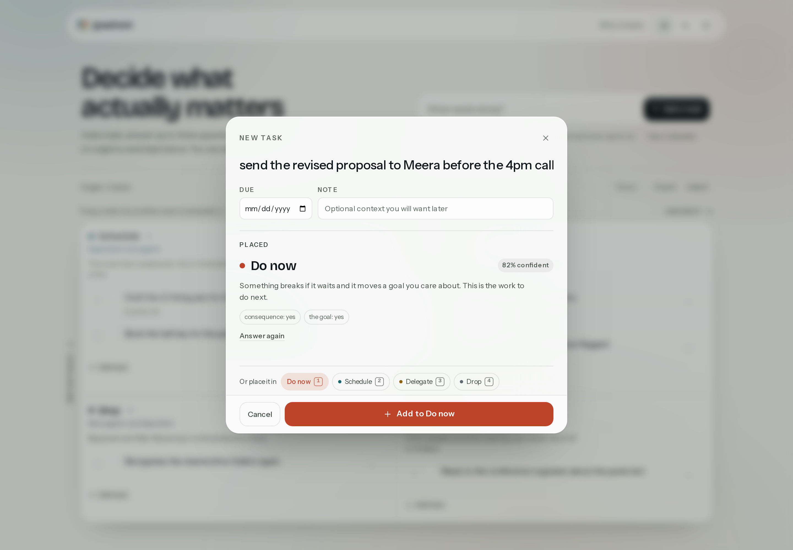
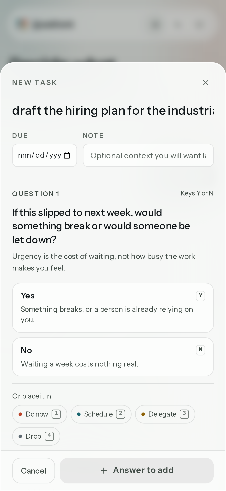
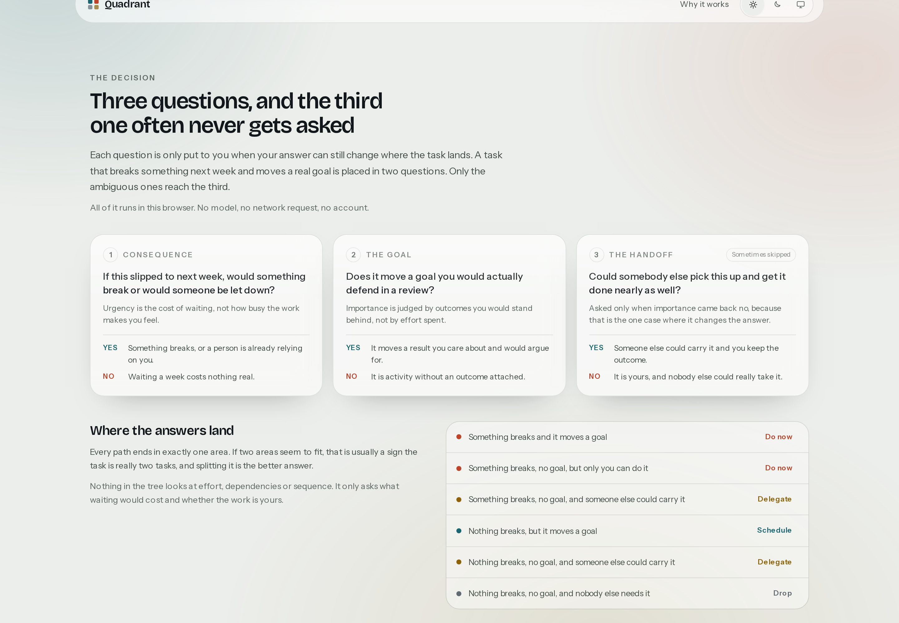

<div align="center">


# Quadrant

**One dialog, a few yes or no answers, and an honest decision about what to do next.**

Add a task and Quadrant asks two or three questions about it. A decision tree places it on the urgency and importance board and tells you why. You can always overrule it.

[](https://quadrant-tasks-nine.vercel.app)
[](https://nextjs.org)
[](https://react.dev)
[](https://www.typescriptlang.org)
[](https://tailwindcss.com)
[](https://motion.dev)
[](#testing)
[](#testing)
[](LICENSE)

[How it decides](#how-it-decides) · [Run locally](#run-locally) · [Testing](#testing)

</div>


## What this is

Most to do lists give you one instruction: more. Quadrant asks what waiting would cost and whether the work is yours. Your answers decide where the task lives, and its position on the board decides how you treat it.

Everything runs in the browser. No account, no database, no analytics, no model call.

## The dialog

Adding a task opens a real dialog, not a one line field. It holds everything about the task in one place: the title, a due date, a note you will want later, and the questions.

| Answering | Decided |
| --- | --- |
|  |  |

On a phone the same dialog becomes a bottom sheet with the actions pinned within reach.



Dark mode comes from the same tokens, not a second stylesheet.


## How it decides

Three questions, asked in an order where each one can still change the outcome. A clear cut task is placed in two answers. Only the ambiguous ones reach a third.

| | Question | Why it is asked | Yes | No |
| --- | --- | --- | --- | --- |
| 1 | If this slipped to next week, would something break or would someone be let down? | Urgency is the cost of waiting, not how busy the work feels | Something breaks, or a person is relying on you | Waiting a week costs nothing real |
| 2 | Does it move a goal you would actually defend in a review? | Importance is judged by outcomes, not effort | It moves a result you care about | It is activity without an outcome |
| 3 | Could somebody else pick this up and get it done nearly as well? | Asked only when importance came back no, because that is the one case where it changes the answer | Someone else could carry it | It is yours, and nobody else could take it |

Where the paths land:

| Answers | Area |
| --- | --- |
| Something breaks and it moves a goal | Do now |
| Something breaks, no goal, but only you can do it | Do now |
| Something breaks, no goal, and someone else could carry it | Delegate |
| Nothing breaks, but it moves a goal | Schedule |
| Nothing breaks, no goal, and someone else could carry it | Delegate |
| Nothing breaks, no goal, and nobody else needs it | Drop |

The page carries the same explanation, including where the method stops being useful.



### Manual paths stay first class

The dialog offers all four areas as chips, the number keys `1` to `4` do the same, and any task can be moved later from its row menu. Choosing an area by hand wins over the questions, and the dialog says so instead of pretending it decided.

### Keyboard

`N` opens the dialog from anywhere, `Y` and `N` answer, `1` to `4` pick an area, `Enter` adds, `Escape` closes, `Backspace` undoes the last answer. Focus stays trapped in the dialog while it is open and returns where it was when it closes.

## The model, on hold

An optional model path exists and is fully tested, but the interface does not use it. `POST /api/triage` is a Next.js route handler that can send the task and four answers to an OpenRouter model and return a quadrant, a reason and a confidence value.

It is parked because the tree is faster, free, deterministic and explainable, and because putting a language model behind a two answer question is not an improvement. The code and its tests stay, so the option is real if it is ever wanted.

```json
// POST /api/triage
{ "task": "send the revised proposal", "answers": { "q1": true, "q2": true, "q3": true, "q4": false } }
```

Set `OPENROUTER_API_KEY` and the route answers from the model. Leave it unset and it answers from the rule, with `mode: "offline"` in the response. 12 requests per IP per 10 minutes, `429` with `Retry-After` beyond that.

## Run locally

```bash
git clone https://github.com/GautamVhavle/quadrant.git
cd quadrant
npm install
npm run dev
```

Open `http://localhost:3000`. No environment variables are needed for the app itself.

| Command | What it does |
| --- | --- |
| `npm run dev` | Next.js dev server |
| `npm run build` | Production build |
| `npm start` | Serve the production build |
| `npm run typecheck` | TypeScript across app, components, lib and tests |
| `npm test` | Unit tests |
| `npm run test:e2e` | Browser tests, building and starting the app |
| `npm run verify` | Typecheck, unit tests, build |
| `node scripts/capture-screenshots.mjs` | Regenerate the screenshots against a running build |
| `node scripts/verify-live.mjs <url>` | Drive the deployed app end to end and report any client error |

| Variable | Purpose |
| --- | --- |
| `OPENROUTER_API_KEY` | Only for the parked model route. The interface never calls it. |
| `OPENROUTER_MODEL` | Any OpenRouter model id. |
| `TRIAGE_REQUESTS_PER_WINDOW` | Optional. Defaults to 12. |
| `TRIAGE_WINDOW_SECONDS` | Optional. Defaults to 600. |

Deploy with `npx vercel --prod`.

## Your data

- Tasks and preferences live in `localStorage` under `quadrant.tasks.v1`, `quadrant.theme.v1` and `quadrant.focus.v1`.
- **Export** downloads the board as JSON. **Import** validates the file before touching your board, so a bad file changes nothing.
- **Focus mode** hides Delegate and Drop without deleting anything.
- Fonts are self hosted in `public/fonts`, so a page load makes no third party requests.

## Project structure

```text
app/
├── layout.tsx           metadata, theme bootstrap, fonts
├── page.tsx             board, decision explainer, method, footer
├── globals.css          glass tokens and the surfaces for both palettes
└── api/triage/route.ts  the parked model path

components/
├── Board.tsx            state, toolbar, dialog orchestration
├── AddTaskDialog.tsx    title, details, questions, verdict, override
├── DecisionExplainer.tsx the questions, the why, and where answers land
├── Matrix.tsx           the 2x2 board and axis labels
├── QuadrantPanel.tsx    one area, its tasks, quick add
├── TaskRow.tsx          checkbox, rename, note, due chip, row menu
├── Header.tsx           brand and theme control
├── Explainer.tsx        the long form method explanation
├── SiteFooter.tsx       credit, links, privacy line
├── Toast.tsx            undo affordance
└── Icons.tsx            inline SVG set

lib/
├── decision.ts          the tree: questions, branches, reasons
├── triage.ts            the flat mapping used by the parked model path
├── taskLogic.ts         task operations and import validation
├── useTasks.ts          state hook built on taskLogic
├── storage.ts           localStorage, theme, focus, export, import
├── types.ts             task and quadrant definitions
└── server/
    ├── openrouter.ts    chat completion with a strict JSON contract
    ├── triageHandler.ts the route contract as a pure, injected function
    └── rateLimit.ts     sliding window limiter, injectable clock
```

## How it is built

- **Next.js App Router.** The board is a client component, the explainer is server rendered, and the model route stays a thin adapter over a pure function.
- **Frosted glass from one token file.** Every surface is translucent with a backdrop blur, a hairline and one shadow step. Light and dark come from the same tokens, resolved as explicit choice, then system preference, then light.
- **The dialog is a layer, not a page.** Thicker glass, a real scrim, a spring entrance, and answer cards that read like a native sheet. Motion collapses under `prefers-reduced-motion`.
- **The decision is a pure function.** `decide(answers)` returns the area, the reason, a confidence and the exact path taken, so the interface never invents an explanation and the tests never need a browser.

## Testing

```bash
npm test          # 132 unit tests
npm run test:e2e  # 28 browser tests
```

Unit tests cover the tree in full: that consequence is asked first, that the third question appears only when importance came back no, that all four areas are reachable, that the path is recorded in order, that no decision is possible with answers missing, that the reason always explains itself, and that confidence is lower when the third question was needed. Plus task notes and due dates, import validation for old and broken boards, and the parked model path with a mocked OpenRouter: request shape, key in the header only, fenced JSON, clamped confidence, and every failure mode including 5xx, 401, network error and timeout.

Browser tests cover the dialog end to end: opening from the button and from `N`, focus landing on the title, Escape and Cancel, both question paths, the third question appearing only when it should, the note and due date reaching storage, overruling with a chip, changing an earlier answer, starting over, answering by keyboard, the disabled add button and phone fit, plus direct placement, reordering, undo, overdue, focus mode, theme persistence, export, a rejected import, the explainer, and the footer links.

## Why four quadrants

The method is usually credited to Dwight Eisenhower, who insisted that urgent work is rarely important and important work is rarely urgent. Stephen Covey made the grid popular.

It is a decision heuristic, not a measurement. It says nothing about sequence, effort or dependencies, and it has a well known failure mode: parking everything in Do now because being busy feels like being valuable. The honest test of the method is whether Schedule has something real in it this week.

## Roadmap

- A weekly review that shows what moved between areas, not just what was completed
- Optional due date suggestions from the answers
- A shared board for two people, if it can be done without accounts
- Wiring the parked model path behind a switch, for the rare task where the tree asks its third question

## License

MIT. See [LICENSE](LICENSE).

<div align="center">

Made with ♥ by [Gautam Vhavle](https://gautamvhavle.xyz/)

</div>
