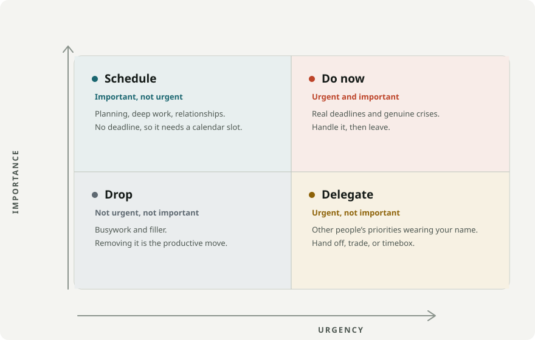
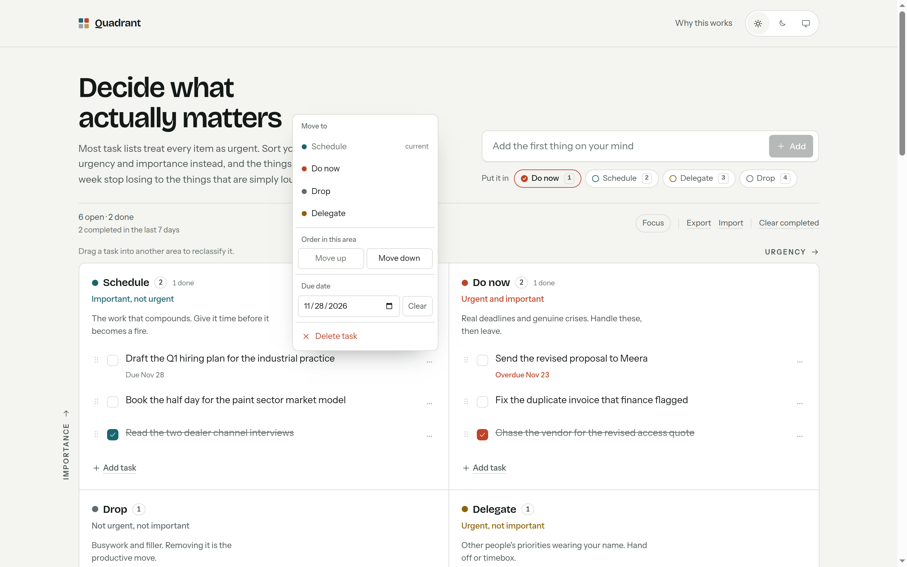
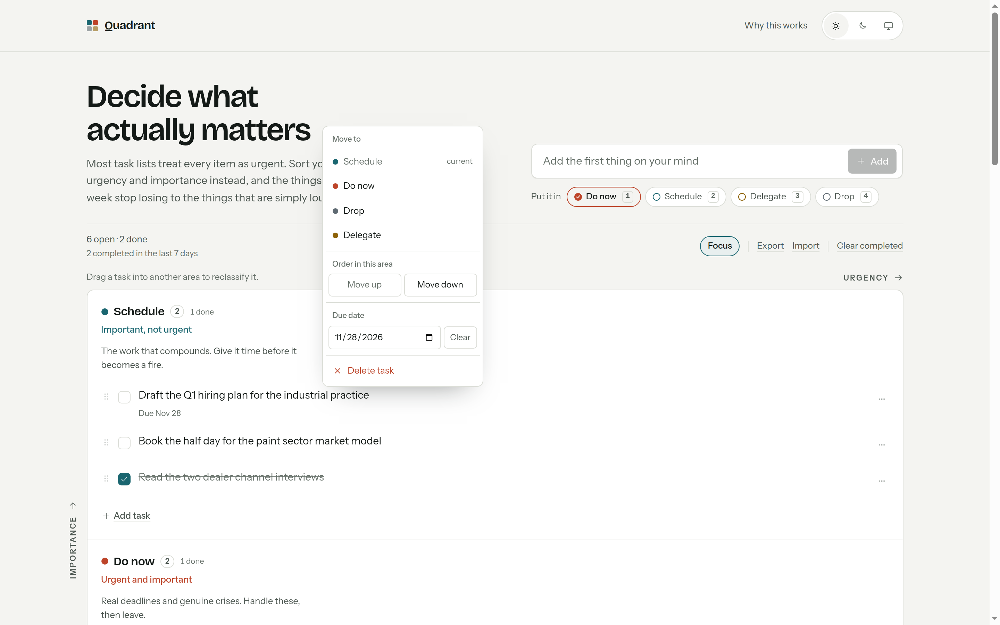

<div align="center">


# Quadrant

**A four-quadrant task board that makes you decide what actually matters.**

Sort any task by urgency and importance. The board tells you what deserves today, and the page explains why the method works while you use it.

[](https://quadrant-tasks-nine.vercel.app)
[](https://react.dev)
[](https://vitejs.dev)
[](https://tailwindcss.com)
[](https://www.typescriptlang.org)
[](#testing)
[](#testing)
[](LICENSE)

[How it works](#how-the-board-works) · [Run locally](#run-it-locally) · [Your data](#your-data) · [Testing](#testing) · [Why the method works](#why-four-quadrants)

</div>


## What this is

Most to-do apps give you one instruction: more. Quadrant asks two questions instead. Is this urgent? Is this important? Your answer decides where the task lives, and its position on the board decides how you treat it.

**Live app: [quadrant-tasks-nine.vercel.app](https://quadrant-tasks-nine.vercel.app)**

Everything runs in the browser. No account, no server, no database, no analytics, and no third party requests after the page loads.

## Features

| | |
| --- | --- |
| **Four quadrant board** | Do now, Schedule, Delegate and Drop on real urgency and importance axes |
| **Drag or menu to reclassify** | Drag on desktop, use the row menu on touch and keyboard |
| **Order inside an area** | Move up and Move down set priority within a quadrant, not just between them |
| **Optional due dates** | A quiet date chip per task, with overdue called out in the quadrant's own colour |
| **Focus mode** | Hide Delegate and Drop in one click when only the work that moves the week matters |
| **Instant capture** | One input with quadrant chips and number keys 1 to 4, plus quick add inside every quadrant |
| **Export and import** | Download the board as JSON, restore it anywhere, undo an accidental clear |
| **Undo on delete** | Deleted tasks and cleared completed lists can be restored from the toast |
| **Light, dark and system themes** | Follows the operating system by default, with an explicit override |
| **Keyboard and screen reader support** | Native checkboxes, labelled controls, visible focus, Escape closes menus |
| **Responsive to 360px** | The matrix becomes a priority-ordered stack on phones with larger touch targets |
| **Installable** | Web app manifest, maskable icons, and no external asset requests |

## How the board works



Importance runs up the vertical axis. Urgency runs right along the horizontal axis. That gives four cells, and each one is an instruction rather than a label.

- **Do now** is capacity constrained. Handle it, then leave.
- **Schedule** is the quadrant that compounds. It has no deadline, which is exactly why it needs one.
- **Delegate** needs doing soon but does not need you specifically.
- **Drop** exists because it was once added, not because it matters.

On a phone the same four areas stack in priority order: Do now, Schedule, Delegate, Drop.

## Screenshots

| Light | Dark |
| --- | --- |
|  |  |

| Task menu | Focus mode |
| --- | --- |
|  |  |

<p align="center">
  
</p>

## Run it locally

Requirements: Node.js 18 or newer and npm.

```bash
git clone https://github.com/GautamVhavle/quadrant.git
cd quadrant
npm install
npm run dev
```

Vite serves the app at `http://localhost:5173`.

| Command | What it does |
| --- | --- |
| `npm run dev` | Development server with hot reload |
| `npm run build` | Production bundle in `dist/` |
| `npm run preview` | Serve the production bundle |
| `npm run typecheck` | TypeScript, including the test files |
| `npm test` | Unit tests for the task logic |
| `npm run test:e2e` | Browser tests, building and serving automatically |
| `npm run verify` | Typecheck, unit tests and build in one pass |

The browser tests need Chromium once per machine:

```bash
npx playwright install chromium
```

## Deploy

The app is a static site, so any static host works. It is deployed on Vercel at [quadrant-tasks-nine.vercel.app](https://quadrant-tasks-nine.vercel.app).

```bash
npx vercel        # preview deployment
npx vercel --prod # production deployment
```

Framework preset: **Vite**. Build command: `npm run build`. Output directory: `dist`.

## Keyboard shortcuts

| Key | Action |
| --- | --- |
| `1` `2` `3` `4` | Choose the destination quadrant while typing a task |
| `Enter` | Add the task |
| `Escape` | Clear the input, cancel a rename, or close an open menu |
| `Tab` | Move through the checkbox, the task title and the row menu |

Touch devices get the same reclassification through the row menu, and the board says so instead of telling you to drag.

## Your data

- Tasks and preferences live in `localStorage` under `quadrant.tasks.v1`, `quadrant.theme.v1` and `quadrant.focus.v1`.
- **Export** downloads the board as JSON. **Import** validates the file before touching your board, so a bad file changes nothing.
- Clearing site data removes the board, which is why export exists.
- Fonts are self hosted in `public/fonts`. After first load there are no requests to Google or any other third party.

## Project structure

```text
src/
├── components/
│   ├── Composer.tsx       capture bar with quadrant chips and shortcuts
│   ├── Matrix.tsx         the 2x2 board, axis labels and focus mode
│   ├── QuadrantPanel.tsx  one quadrant, its tasks, quick add, quiet scrolling
│   ├── TaskRow.tsx        checkbox, inline rename, due chip, row menu
│   ├── Explainer.tsx      the long form explanation of the method
│   ├── Header.tsx         brand and theme control
│   ├── Toast.tsx          undo affordance
│   └── Icons.tsx          inline SVG set
├── lib/
│   ├── taskLogic.ts       pure task operations, import validation, week counts
│   ├── useTasks.ts        state hook built on taskLogic
│   ├── storage.ts         localStorage, theme, focus, export and import
│   ├── types.ts           task and quadrant definitions
│   └── utils.ts           class merging and ids
├── App.tsx
├── index.css              design tokens for both palettes
├── fonts.css              generated @font-face rules
└── main.tsx

tests/
├── taskLogic.test.ts      34 unit tests over the pure logic
└── e2e/board.spec.ts      10 browser tests over the real experience

scripts/
├── fetch-fonts.mjs        re-downloads and rewrites the self hosted fonts
└── og-card.html           source for the social preview image
```

## How it is built

- **React 18 with Vite.** About 198 kB of JavaScript and 21 kB of CSS before gzip.
- **Tailwind with CSS custom properties.** One token file drives both palettes, instead of `dark:` classes repeated across every component.
- **Task logic is pure functions** in `taskLogic.ts`. `useTasks` only holds state and calls them, which is why behaviour is testable without a DOM.
- **No component library and no runtime CSS-in-JS.**
- **Theme resolution order:** explicit choice, then system preference, then light. `color-scheme` is declared so form controls and scrollbars follow.
- **Menus use fixed positioning** computed from the trigger, so a long board, a short viewport or a scrolling quadrant cannot clip them.

## Testing

```bash
npm test          # 34 unit tests
npm run test:e2e  # 10 browser tests
```

The unit suite covers what breaks silently: adding, trimming and clamping titles, completion timestamps, moving between quadrants, reordering inside a quadrant, per quadrant counts, the last seven days count, overdue detection, and import validation for malformed, partial and unknown quadrant files.

The browser suite covers what a unit test cannot: capture and persistence across a reload, keyboard quadrant selection, reclassifying from the row menu, reordering, completing then clearing with undo, setting an overdue date, focus mode, theme persistence, JSON export, and a rejected import that leaves the board intact.

Both suites run in CI, in separate jobs.

## Why four quadrants

The method is usually credited to Dwight Eisenhower, who insisted that urgent work is rarely important and important work is rarely urgent. Stephen Covey made the grid popular.

It is a decision heuristic, not a measurement. It says nothing about sequence, effort or dependencies, and it has a well known failure mode: parking everything in Do now because being busy feels like being valuable. The honest test of the method is whether Schedule has something real in it this week.

The app explains all of this inside the page, including where the method stops being useful.

## Roadmap

- A weekly review that shows what moved between quadrants, not just what was completed
- Keyboard-only reordering without opening the row menu
- Optional pin and archive for tasks that survive a sprint
- Project or area tags that filter the whole board
- Optional sync for people who want the same board on two devices

## Contributing

Issues and pull requests are welcome. Keep changes focused, run `npm run verify` and `npm run test:e2e` before opening a pull request, and explain any change to the interaction model, because the board is the product.

## License

MIT. See [LICENSE](LICENSE).
